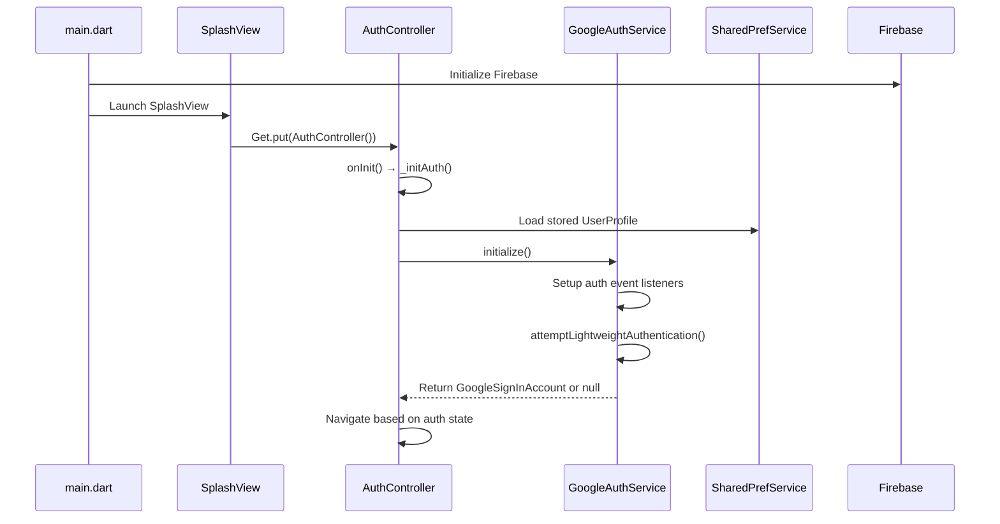
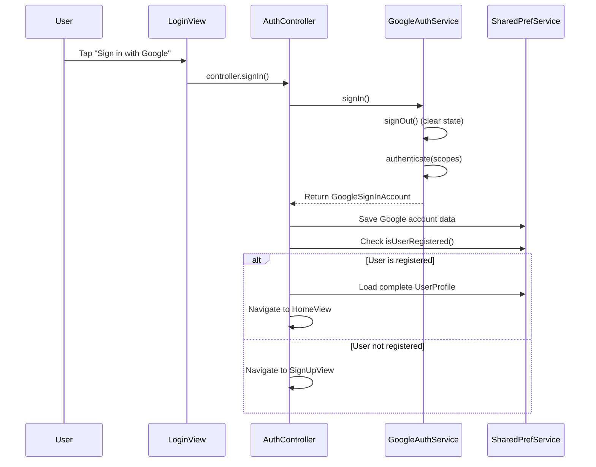
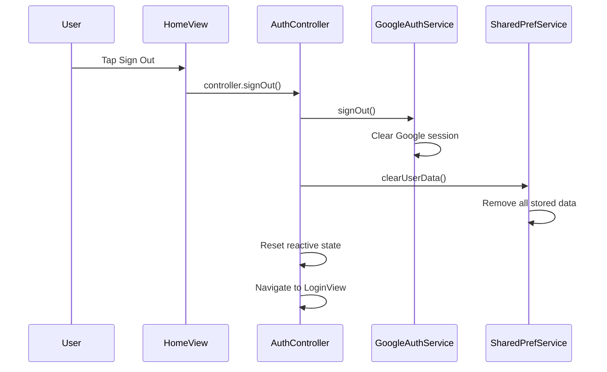

# Authentication System Documentation

## Overview

The fiwe application implements a robust authentication system using Google Sign-In with Firebase integration, GetX state management, and SharedPreferences for session persistence. The system supports auto-login, user registration flow, and secure session management across app restarts.

## Architecture Components

### Core Components
- **`AuthController`**: Central state management using GetX reactive patterns
- **`GoogleAuthService`**: Google Sign-In wrapper with stream-based event handling
- **`SharedPrefService`**: Local data persistence for user profiles and authentication state
- **`UserProfile`**: Data model for comprehensive user information

## Detailed Authentication Flow

### 1. App Initialization Sequence



### 2. Authentication State Management

#### Reactive State Variables
```dart
final Rx<GoogleSignInAccount?> _user = Rx<GoogleSignInAccount?>(null);
final RxBool _isInitializing = RxBool(true);
final RxBool _isSigningUp = RxBool(false);
final Rx<UserProfile?> _userProfile = Rx<UserProfile?>(null);
```

#### Key State Properties
- **`isLoggedIn`**: `_user.value != null`
- **`isInitializing`**: Loading state during auth setup
- **`isSigningUp`**: Registration process state
- **`userProfile`**: Complete user information including registration status

### 3. Auto-Login Mechanism

The system implements a sophisticated auto-login flow that checks multiple authentication layers:

#### Step-by-Step Process:
1. **Stored Data Check**: Verify if authentication data exists in SharedPreferences
2. **Lightweight Authentication**: Use Google Sign-In's `attemptLightweightAuthentication()`
3. **Session Validation**: Refresh and validate existing tokens
4. **Fallback Handling**: Clear corrupted data and fallback to login screen

```dart
Future<GoogleSignInAccount?> initialize() async {
  try {
    await _googleSignIn.initialize();
    
    // Set up real-time authentication event listeners
    _googleSignIn.authenticationEvents
        .listen(_handleAuthEvent)
        .onError(_handleAuthError);
    
    // Check for stored authentication data
    final hasStoredAuth = await hasStoredAuthData();
    if (hasStoredAuth) {
      final account = await _googleSignIn.attemptLightweightAuthentication();
      if (account != null) {
        await _saveAuthData(account);
        return account;
      } else {
        await _clearAuthData();
      }
    }
    
    return null;
  } catch (e) {
    await _clearAuthData();
    return null;
  }
}
```

### 4. User Sign-In Process

#### Manual Sign-In Flow:


#### Error Handling:
- **`GoogleSignInException.canceled`**: User cancelled sign-in
- **`GoogleSignInException`**: Platform-specific Google Sign-In errors
- **Generic exceptions**: Network or unexpected errors
- **User feedback**: Non-blocking snackbar notifications

### 5. Registration Flow

For new users who haven't completed registration:

#### SignUp Process:
```dart
Future<void> completeSignUp({
  required String name,
  required String email,
  required String dateOfBirth,
  required String pinCode,
  File? profileImage,
}) async {
  // Create comprehensive user profile
  final profile = UserProfile(
    name: name,
    email: email,
    dateOfBirth: dateOfBirth,
    pinCode: pinCode,
    profileImagePath: profileImage?.path,
    displayName: _user.value?.displayName,
    idToken: await _user.value!.authentication.idToken,
    isRegistered: true,
  );
  
  // Persist to SharedPreferences
  await SharedPrefService.saveUserProfile(profile);
  await SharedPrefService.markUserAsRegistered();
  
  // Update reactive state
  _userProfile(profile);
  
  // Navigate to home
  _navigateToHome();
}
```

### 6. Session Persistence Strategy

#### Multi-Layer Persistence:
1. **Google Sign-In SDK**: Platform-specific secure storage (Keystore/Keychain)
2. **SharedPreferences**: Additional user profile and registration state
3. **Firebase Authentication**: Token management and validation

#### Stored Data:
```dart
// Authentication tokens and basic info
Constants.loginEmailKey
Constants.loginUserIdKey
Constants.loginUsernameKey
Constants.loginTokenKey

// Complete user profile
Constants.userNameKey
Constants.userEmailKey
Constants.userDateOfBirthKey
Constants.userPinCodeKey
Constants.userProfileImageKey
Constants.userDisplayNameKey
Constants.userIdTokenKey
Constants.isUserRegisteredKey
```

### 7. Sign-Out Process

#### Complete Cleanup Flow:


### 8. Navigation Management

#### Safe Navigation Patterns:
```dart
void _navigateToLogin() {
  if (Get.currentRoute != '/LoginView') {
    Future.delayed(const Duration(milliseconds: 100), () {
      if (!Get.isDialogOpen! && !Get.isBottomSheetOpen!) {
        Get.offAll(() => const LoginView());
      }
    });
  }
}
```

#### Navigation Rules:
- **Route checking**: Prevent duplicate navigation
- **State verification**: Check for open dialogs/bottom sheets
- **Delayed execution**: Stabilize navigation flow
- **Stack replacement**: Use `Get.offAll()` to prevent back navigation

### 9. Error Handling & Security

#### Security Measures:
- **Secure Token Storage**: Leverages platform-specific secure storage
- **No Manual Token Handling**: Delegates to trusted SDKs
- **Stream Error Handling**: Graceful degradation on auth errors
- **Data Validation**: Comprehensive null checks and error boundaries

#### Error Recovery:
- **Corrupted Data**: Automatic cleanup and fallback to login
- **Network Issues**: Retry mechanisms through Google Sign-In SDK
- **Token Expiry**: Automatic refresh via Google Sign-In
- **Platform Failures**: Graceful fallback with user notification

### 10. State Synchronization

#### Stream-Based Updates:
```dart
// Real-time authentication event handling
_googleSignIn.authenticationEvents
    .listen(_handleAuthEvent)
    .onError(_handleAuthError);

// Controller stream listener
_authService.userStream.listen((newAccount) {
  if (_user.value != newAccount) {
    _user(newAccount);
    
    if (newAccount != null) {
      _handleAuthenticatedUser(newAccount);
    } else {
      _navigateToLogin();
    }
  }
});
```

#### Reactive UI Updates:
- **GetX Observables**: Automatic UI updates without setState
- **State Consistency**: Single source of truth across views
- **Memory Management**: Proper disposal in controller lifecycle

## Configuration Requirements

### Android Configuration:
- **Internet Permission**: AndroidManifest.xml
- **Google Services**: build.gradle.kts configuration
- **SHA-1 Fingerprints**: Firebase Console registration
- **google-services.json**: Project configuration file

### iOS Configuration:
- **GoogleService-Info.plist**: Firebase configuration
- **Info.plist URL Scheme**: Bundle ID consistency
- **AppDelegate.swift**: Firebase initialization

## File Structure

### Core Authentication Files:
```
lib/src/
├── controllers/
│   └── auth_controller.dart          # Central authentication state management
├── services/
│   ├── google_auth_service.dart      # Google Sign-In wrapper service
│   └── shared_pref_service.dart      # Local data persistence
├── views/
│   ├── login/
│   │   ├── login_view.dart           # Login UI
│   │   ├── signup_view.dart          # Registration UI
│   │   └── splash_view.dart          # Initial loading screen
│   └── home/
│       └── home_view.dart            # Authenticated user home
└── utils/
    ├── constants.dart                # Storage keys and constants
    └── strings.dart                  # UI text constants
```

## Testing & Validation

The system supports comprehensive testing through:
- **Unit Tests**: Service layer validation
- **Integration Tests**: Authentication flow testing
- **Error Simulation**: Network and platform failure scenarios
- **State Persistence**: Cross-session validation

## Key Features

### 1. Seamless Auto-Login
- **No User Interaction**: Automatic authentication on app restart
- **Fast Initialization**: Optimized for quick app startup
- **Graceful Fallback**: Handles token expiry and network issues

### 2. Dual-Layer Persistence
- **Primary**: Google Sign-In SDK's secure storage
- **Secondary**: SharedPreferences for additional user data
- **Synchronization**: Automatic sync between layers

### 3. Reactive State Management
- **GetX Integration**: Reactive UI updates without manual setState
- **Memory Efficient**: Proper resource cleanup and disposal
- **Type Safe**: Strong typing with null safety

### 4. Comprehensive Error Handling
- **User-Friendly Messages**: Clear feedback without technical jargon
- **Debug Logging**: Detailed error information for development
- **Recovery Mechanisms**: Automatic retry and fallback strategies

### 5. Security Best Practices
- **No Local Password Storage**: Relies on secure OAuth tokens
- **Platform Security**: Leverages Android Keystore and iOS Keychain
- **Minimal Exposure**: Limited error information disclosure

## Development Guidelines

### 1. Adding New Authentication Features
- Extend `AuthController` for new authentication methods
- Add corresponding methods to `GoogleAuthService`
- Update `UserProfile` model if new data fields are needed
- Implement proper error handling and user feedback

### 2. Testing Authentication Flow
- Use unit tests for service layer validation
- Implement integration tests for complete flow testing
- Test error scenarios and edge cases
- Validate state persistence across app restarts

### 3. Debugging Authentication Issues
- Check Firebase Console for project configuration
- Validate SHA-1 fingerprints for Android
- Verify bundle ID consistency for iOS
- Review debug logs for detailed error information

This authentication system provides a production-ready, secure, and user-friendly authentication experience with robust error handling and state management.