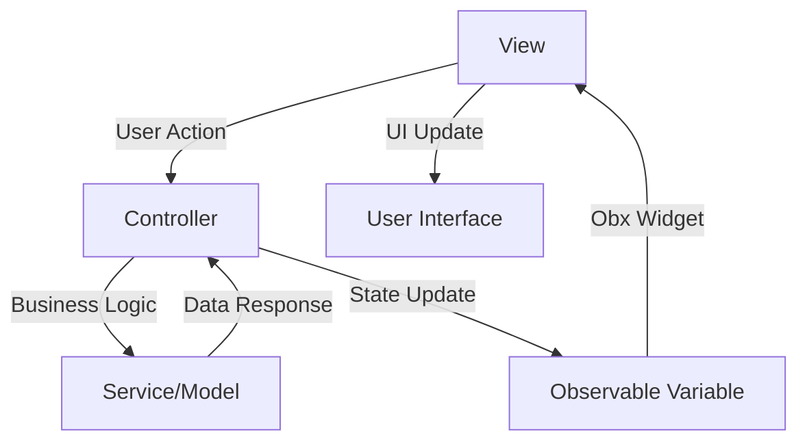

# MVC Architecture with GetX Controllers

## Overview
The application has been refactored to follow the **Model-View-Controller (MVC)** pattern using **GetX** state management. This separation ensures better code maintainability, testability, and follows reactive programming principles.

## Architecture Pattern

### 🏗️ **Structure**
```
lib/src/
├── controllers/          # Business Logic Layer (Controllers)
│   ├── auth_controller.dart
│   ├── login_controller.dart
│   └── signup_controller.dart
├── views/               # Presentation Layer (Views)
│   └── login/
│       ├── login_view.dart
│       ├── signup_view.dart
│       └── splash_view.dart
├── widgets/             # Reusable UI Components
│   ├── custom_button.dart
│   ├── custom_text_field.dart
│   └── profile_image_picker.dart
├── services/            # Data Layer (Models/Services)
│   ├── google_auth_service.dart
│   ├── shared_pref_service.dart
│   └── http_service.dart
└── utils/               # Utilities
    ├── constants.dart
    ├── strings.dart
    └── exceptions.dart
```

## 🎯 **Key Changes Made**

### 1. **Controllers (Business Logic)**
- **AuthController**: Main authentication logic and navigation flow
- **LoginController**: Login-specific business logic and loading states
- **SignUpController**: Form validation, image selection, and signup flow
- **ProfileImageController**: Image picking and management

### 2. **Views (UI Layer)**
- Converted from `StatefulWidget` to `StatelessWidget`
- All state management moved to controllers
- UI reactivity handled by `Obx()` widgets
- No direct business logic in views

### 3. **Reactive State Management**
- Using `Rx<Type>()` for observable variables
- `Obx()` widgets for automatic UI updates
- No more `setState()` calls
- Cleaner separation of concerns

## 📋 **GetX Patterns Implemented**

### **Observable Variables**
```dart
// In Controllers
final RxBool _isLoading = RxBool(false);
final Rx<File?> _selectedImage = Rx<File?>(null);
final RxString _errorMessage = RxString('');

// Getters
bool get isLoading => _isLoading.value;
File? get selectedImage => _selectedImage.value;
```

### **Reactive UI Updates**
```dart
// In Views
Obx(() => CustomButton(
  text: 'Sign Up',
  onPressed: controller.isLoading ? null : controller.handleSignUp,
  isLoading: controller.isLoading,
))
```

### **Controller Lifecycle Management**
```dart
@override
void onInit() {
  super.onInit();
  // Initialize data
}

@override
void onClose() {
  // Dispose resources
  textController.dispose();
  super.onClose();
}
```

## 🔄 **Data Flow**



## 🎨 **Component Examples**

### **Controller Implementation**
```dart
class SignUpController extends GetxController {
  // Observable variables
  final RxBool _isLoading = RxBool(false);
  final Rx<File?> _selectedImage = Rx<File?>(null);
  
  // Form controllers
  final nameController = TextEditingController();
  final emailController = TextEditingController();
  
  // Getters
  bool get isLoading => _isLoading.value;
  File? get selectedImage => _selectedImage.value;
  
  // Business logic methods
  Future<void> handleSignUp() async {
    _isLoading.value = true;
    // Signup logic
    _isLoading.value = false;
  }
  
  @override
  void onClose() {
    nameController.dispose();
    emailController.dispose();
    super.onClose();
  }
}
```

### **View Implementation**
```dart
class SignUpView extends StatelessWidget {
  @override
  Widget build(BuildContext context) {
    final SignUpController controller = Get.put(SignUpController());
    
    return Scaffold(
      body: Form(
        key: controller.formKey,
        child: Column(
          children: [
            // Reactive UI
            Obx(() => CustomButton(
              text: 'Sign Up',
              onPressed: controller.isLoading ? null : controller.handleSignUp,
              isLoading: controller.isLoading,
            )),
          ],
        ),
      ),
    );
  }
}
```

## ✅ **Benefits Achieved**

1. **Separation of Concerns**: Clear separation between UI and business logic
2. **Testability**: Controllers can be easily unit tested
3. **Reusability**: Controllers can be reused across different views
4. **Memory Management**: Proper disposal of resources in controller lifecycle
5. **Reactive Programming**: Automatic UI updates with minimal boilerplate
6. **Code Maintainability**: Easier to modify and extend functionality
7. **Performance**: Efficient UI rebuilds only for changed observables

## 🛠️ **Usage Guidelines**

### **Creating a New Feature**
1. Create a controller extending `GetxController`
2. Define observable variables with `Rx<Type>()`
3. Implement business logic methods
4. Create a `StatelessWidget` view
5. Use `Get.put()` to initialize controller
6. Wrap reactive UI elements with `Obx()`

### **State Management Best Practices**
- Keep business logic in controllers
- Use meaningful getter names
- Dispose resources in `onClose()`
- Use `Obx()` only for widgets that need reactivity
- Validate form data in controllers, not views

## 🎯 **Next Steps**
- Add unit tests for controllers
- Implement error handling patterns
- Add more reusable components
- Consider using GetX dependency injection for services
- Implement state persistence for complex forms